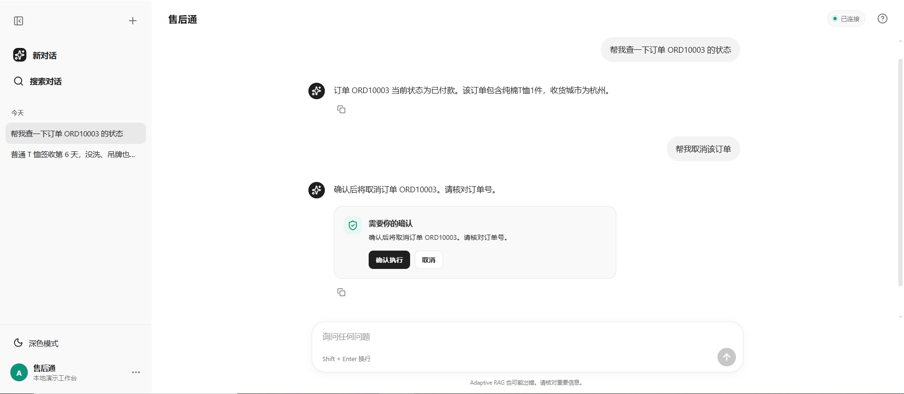
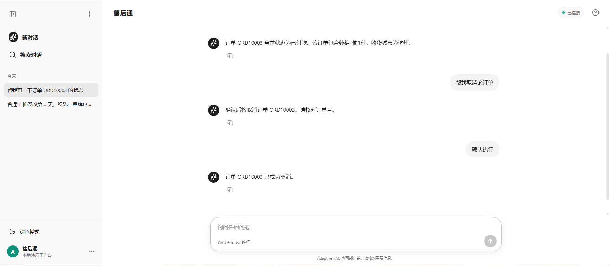
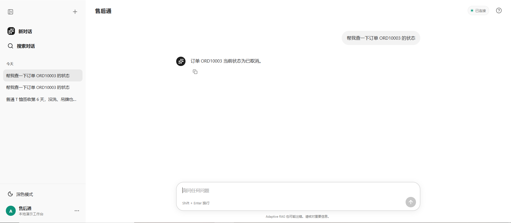
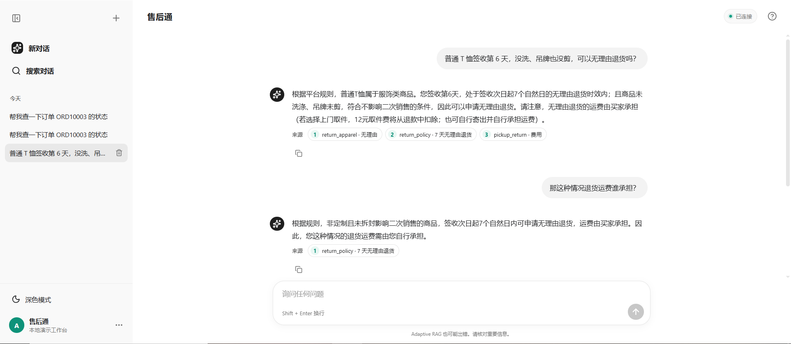
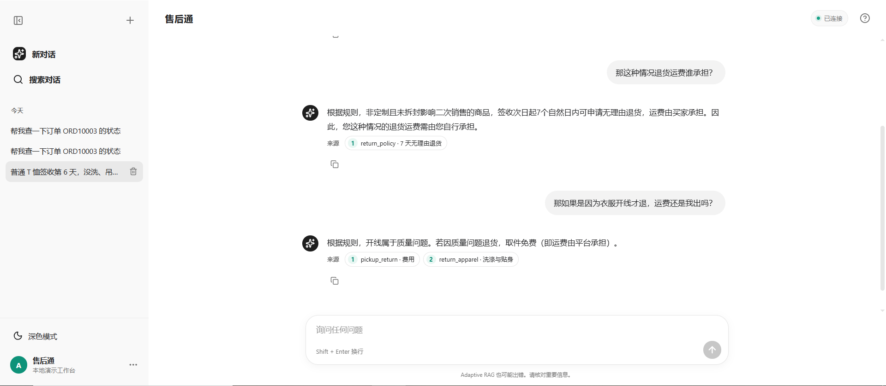

# 售后通 · AfterSale RAG

**售后通是一个面向电商售后的自适应 RAG 智能客服系统。** 用户问退换货规则，系统检索知识库并给出条款引用。用户查订单或物流，系统调用业务工具读取数据。用户接着说「帮我取消该订单」，系统可以沿用上一轮的订单号，展示确认卡片，等用户点击确认后再执行。

系统根据问题选择直接回答、单跳检索、多跳检索、工具调用或拒答。进入多跳检索后，系统根据证据是否充分决定继续补搜还是生成回答。对话上下文由近期消息和滚动摘要共同提供，并通过 SQLite 持久化。

后端基于 **FastAPI 和 LangGraph**，前端使用 **React 和 TypeScript**。在 65 条售后知识检索样例上，混合检索结合 Cross-Encoder 精排取得 **89.23% 的 P@1** 和 **96.15% 的 Recall@3**。

## 功能演示

### 多轮查单与取消确认

用户先查询 `ORD10003`，随后只说「帮我取消该订单」。系统沿用上一轮的订单号，生成待确认动作，在卡片中展示操作对象。用户点击「确认执行」后，系统执行取消。再次查询同一订单，状态变为「已取消」。



<details>
<summary>查看确认执行和状态复查</summary>

点击确认后，系统返回取消结果。



重新查询订单状态，验证取消结果。



</details>

### 多轮政策问答与引用

用户先咨询普通 T 恤能否无理由退货，再追问「那这种情况退货运费谁承担？」系统结合前文按无理由退货场景回答，并展示对应的知识库来源。


<details>
<summary>查看后续追问：衣服开线后，退货运费谁承担？</summary>

用户在同一段对话中补充「衣服开线」这一情况。系统改按质量问题场景回答，引用服饰售后与取件费用条款，说明因质量问题退货时可免费取件。



</details>

## 自适应检索（Adaptive RAG）

系统先根据用户意图和问题内容选择处理路径。问候可以直接回答，售后政策问题进入知识库检索，订单与物流问题调用业务工具。

进入检索后，单跳路径完成一轮检索后生成回答。多跳路径会逐轮检查证据是否覆盖问题中的关键条件。如果发现缺口，就围绕缺失条款改写查询并继续检索，直到证据充分或达到跳数上限。

例如，用户问「普通 T 恤签收第 6 天还能无理由退货吗？审核通过后银行卡多久能收到退款？」回答需要覆盖**服饰退货资格**和**银行卡退款时效**。如果第一轮只找到退货条件，多跳路径可以针对退款时效补搜。

## 系统设计

| 处理路径 | 典型场景 | 处理方式 |
| --- | --- | --- |
| `DIRECT` | 问候、闲聊 | 直接生成回复 |
| `SINGLE` | 单项政策咨询 | 检索相关条款并生成带引用的回答 |
| `MULTI` | 涉及多个条件或条款的问题 | 根据证据充分性判断是否继续检索，受最大跳数约束 |
| `AGENT` | 查询订单、跟踪物流、发起售后操作 | Planner 规划工具调用，Executor 校验参数与权限后执行 |
| `REFUSE` | 越权请求或超出售后服务范围的问题 | 拒绝请求或提示下一步处理方式 |

- **混合检索**：BM25 与向量召回并行，通过 RRF 融合排序。启用本地 Cross-Encoder 后，对候选文档进一步精排。
- **多轮会话**：SQLite 保存原始消息、滚动摘要和摘要游标。模型优先使用近期对话，较早的内容通过摘要带入上下文。
- **写操作确认**：取消订单等高风险操作先返回 `pending_action`。确认请求携带 `confirm_action_id`，后端校验用户、会话和业务状态，并通过幂等机制处理重复请求。

## 检索评测

在同一组 **65 条售后知识检索样例**上，按知识文档 ID 对照标注评估各方案。启用 Cross-Encoder 精排的方案取得 **89.23% 的 P@1** 和 **96.15% 的 Recall@3**。

| 检索方案 | P@1 | Recall@3 |
| --- | ---: | ---: |
| BM25 | 80.00% | 90.00% |
| 向量检索 | 81.54% | 94.62% |
| 混合检索 + RRF | 83.08% | 94.62% |
| 混合检索 + RRF + Cross-Encoder 精排 | **89.23%** | **96.15%** |

以上是固定演示知识库上的历史检索结果，统计的是文档检索表现。评测样例见 [检索数据集](eval/dataset/rag_eval.jsonl)。启用与评测一致的检索配置后，在项目根目录运行：

```powershell
uv run python -m eval.runner --task retrieval
```

结果写入 `eval/reports/`。复现时可通过 `/api/v1/capabilities` 核对实际启用的检索和精排后端。

## 快速开始

需要 Python 3.11+、[uv](https://docs.astral.sh/uv/) 和 Node.js 20.19+ 或 22.12+。以下为 Windows PowerShell 示例。

**1. 安装后端依赖并创建本地配置**

```powershell
uv sync --locked --extra dev
if (-not (Test-Path .env)) { Copy-Item .env.example .env }
```

要接入线上模型，在本地 `.env` 填写 `DEEPSEEK_API_KEY`，并通过 `DEEPSEEK_BASE_URL` 和 `DEEPSEEK_MODEL` 选择服务地址及模型。百炼兼容接口示例见 [`.env.example`](.env.example)。API Key 留空时使用离线模式。请勿提交 `.env`。

**2. 初始化演示数据并启动后端**

```powershell
uv run python -m scripts.seed_demo
uv run uvicorn app.asgi:app --host 127.0.0.1 --port 8000
```

**3. 另开终端启动前端**

```powershell
cd frontend
npm ci
npm run dev
```

- [前端工作台](http://127.0.0.1:5173)
- [FastAPI 接口文档](http://127.0.0.1:8000/docs)
- [运行能力检查](http://127.0.0.1:8000/api/v1/capabilities)

如需启用本地 BGE，运行 `uv sync --locked --extra dev --extra rerank`，并在 `.env` 将 `LOCAL_EMBEDDING_ENABLED` 和 `CROSS_ENCODER_ENABLED` 设为 `true`。首次使用需下载模型。

更多信息见 [接口说明](docs/api.md) 和 [部署说明](docs/deployment.md)。演示政策与订单均为虚构数据。

## 致谢与许可证

本项目基于 [JEen-wang/Adaptive-rag](https://github.com/JEen-wang/Adaptive-rag) 开发，沿用 [MIT 许可证](LICENSE)。第三方依赖与模型说明见 [THIRD_PARTY_NOTICES.md](THIRD_PARTY_NOTICES.md)。
